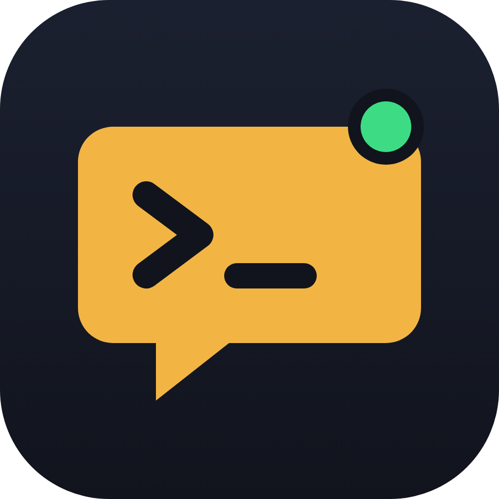
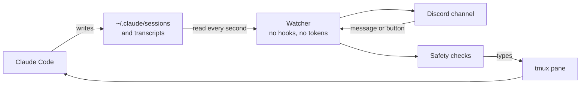

<p align="center">
  
</p>

<p align="center">
  <em>Every Claude Code session on your computer, in its own Discord channel.</em>
</p>

<p align="center">
  
  
  
  
</p>

<p align="center">
  <a href="#install"><strong>Install</strong></a>
  &middot; <a href="#setup">Setup</a>
  &middot; <a href="#how-it-works">How it works</a>
  &middot; <a href="#faq">FAQ</a>
</p>

---

claude-code-discord-sync mirrors each Claude Code session running on your computer into its own channel in a
Discord server you own. You see Claude's replies, its tool calls and its questions as they happen, and you can
answer prompts with buttons or type messages into the session from your phone.

It is a small watcher that runs next to Claude Code, not a hook, plugin or MCP server. It reads the files Claude
Code already writes under `~/.claude` and types into tmux, so it adds no tokens or context to your sessions and
Claude never knows it is there.

## Install

**Homebrew** (macOS and Linux):

```sh
brew tap h3692/tap
brew trust h3692/tap
brew install claude-code-discord-sync
```

Homebrew asks you to trust a tap before it installs from it.

**npm** (anywhere with Node 24.12 or later):

```sh
npm install -g --allow-remote=all https://github.com/h3692/claude-code-discord-sync/releases/latest/download/claude-code-discord-sync.tgz
```

`--allow-remote=all` lets npm install from a URL; newer npm versions refuse without it.

Requirements:

- Node.js 24.12 or later
- tmux (macOS and Linux). Sessions must run inside tmux to be controlled from Discord. Sessions outside tmux are
  mirrored read-only.
- Claude Code

Upgrading this tool with Homebrew or npm doesn't need setup again: the login service runs the installed
`claude-code-discord-sync` command, whose path stays the same. The new version starts at your next login, or re-run
setup to restart it now. Switching Node versions with nvm does. A global npm
install belongs to the Node version that was active when you installed it, and the login service runs that copy.
After switching versions, install again and re-run `claude-code-discord-sync setup`.
`claude-code-discord-sync status` tells you if the Node the service runs has gone missing.

### Windows

The recommended route is **WSL 2**. Run Claude Code and this tool inside WSL, with tmux, and follow the Linux
steps above. Both must run on the same side: a watcher inside WSL can't see a Claude Code running on Windows, and
the other way round.

Native Windows is **experimental**. It uses [psmux](https://github.com/psmux/psmux) in place of tmux:

```powershell
winget install marlocarlo.psmux
```

On native Windows, sessions are mirrored read-only unless you set `CCDS_WINDOWS_TYPING=1`, and messages with more
than one line can't be typed yet. If you try it, please open an
[issue](https://github.com/h3692/claude-code-discord-sync/issues) with the output of
`claude-code-discord-sync status`.

## Setup

```sh
claude-code-discord-sync setup
```

You do three things:

1. Create an application in the [Discord Developer Portal](https://discord.com/developers/applications) (setup
   opens it for you): **New Application**, give it a name, **Create**.
2. On its **Bot** page, click **Reset Token**, then **Copy**.
3. Paste the token into setup. It is hidden as you paste.

Setup does the rest:

- Finds your Discord user ID from the application's owner and asks you to confirm that only you may type into
  sessions.
- Turns on **Message Content Intent**. If Discord won't let it, setup opens the Bot page and waits while you flip
  the switch.
- Gives the bot the logo as its avatar if it has none.
- Opens an invite link with the right permissions and waits for you to add the bot to a server. Use a private
  server that only you are in; a new, empty one is best. If the bot is already in a server, setup uses it, and
  asks which one if there are several.
- Checks the bot's permissions in that server and reopens the invite if any are missing.
- Stores the token in the OS secret store: the Keychain on macOS, DPAPI on Windows, and a file only you can read
  (mode 0600) on Linux.
- Installs a login service and starts it: a LaunchAgent on macOS, a systemd user unit on Linux, and a `Run` key
  under `HKCU` on Windows.

Re-running setup is safe. It finds the stored token and asks whether to keep the existing bot, so you never have to
reset the token again.

Then start Claude Code inside tmux and its channel appears within a few seconds:

```sh
tmux new -s work
claude
```

Setup warns you if the bot is **Public**. Discord's API can't change that, so turn off **Public Bot** on the Bot
page yourself; otherwise anyone with the link can add your bot to their server.

## What you see in Discord

- **One channel per session** under the **Claude Sessions** category, named after the session and its folder, and
  renamed once Claude gives the conversation a title. Channels you can't type into start with 🔒 and say why: the
  session isn't running inside tmux, it's a background session, or typing on Windows is off.
- **Claude's replies** as normal messages. Markdown is kept, tables become code blocks and long text is split.
  Prompts you type in the terminal show up as quotes. Thinking is never shown.
- **A live activity message** for each run of tool calls, edited in place, with one line per tool that changes from
  running to done or failed.
- **A subagent panel** for each batch of agents, with type, description, status and duration.
- **Approval and question cards** when Claude is waiting on you. They ping you, show the prompt, and have one
  button per option when the option list can be read reliably. Otherwise they show the prompt and a hint to answer
  with `!keys` or `!type`.
- **A done ping** when a turn finishes, such as `Done in 1m 12s`, plus how many background agents are still running.
- **Ended sessions** move to **Ended Sessions** and are deleted after one hour, unless you archive them.

Running `/clear` or `/resume` keeps the same channel and posts a divider.

## Using it from Discord

Type in a session's channel and the text goes into the session, followed by Enter. If Claude is busy, Claude Code
queues the message as it would at the terminal. A check-mark reaction means it was delivered. Slash commands such
as `/compact` pass through like any other text.

When a card has buttons, tap one to answer. The watcher only types the answer if the same prompt is still on
screen; otherwise it tells you the prompt changed. Plain messages are refused while a prompt is open, so they can't
land in it by accident.

| Message | What happens |
|---|---|
| `!keys <keys>` | Sends up to 20 raw keys, for prompts the buttons can't handle (multi-select, tall prompts). Allowed: digits `0`–`9`, `Up`, `Down`, `Left`, `Right`, `Enter`, `Escape`, `Tab`, `BTab` (Shift-Tab), `Space`, `BSpace`. Example: `!keys Down Enter`. |
| `!type <text>` | Types the text even while a prompt is open, for example to fill in an "Other" answer. |
| `!archive` | In a live session, keeps the channel when the session ends by moving it to **Archive** instead of deleting it. In an ended session, archives it now. Archive categories fill up at 50 channels, then `Archive 2`, `Archive 3` and so on are created. |

Any other message starting with `!` is refused. Claude Code runs input that starts with `!` as a shell command, so
the watcher never types it, and `!type` refuses text that starts with `!` too.

## Commands

| Command | What it does |
|---|---|
| `claude-code-discord-sync setup` | Connects your bot and server, stores the token and installs the login service. Safe to re-run. |
| `claude-code-discord-sync start` | Runs the watcher in the foreground. Stop it with Ctrl-C. Only one watcher runs at a time, so this exits if the login service is already running. |
| `claude-code-discord-sync status` | Shows the config, whether a token is stored, the login service's state and whether the Node and program paths it runs still exist, the tmux version, and every live session with whether it can be typed into and, if not, why. On Windows it also prints each session's raw start time next to the measured one. |
| `claude-code-discord-sync uninstall` | Removes the login service, the stored token and the config folder. Your Discord server, bot and channels are left alone. |

## How it works



- **Reading.** Claude Code keeps a registry of live sessions in `~/.claude/sessions` and a transcript of each
  conversation under `~/.claude/projects`. The watcher reads both and posts what is new.
- **Prompts.** When a session is waiting on you, the watcher reads the prompt from the tmux pane to build the card
  and its buttons.
- **Typing.** Messages and button clicks from you are checked, then pasted into the session's tmux pane with
  `tmux paste-buffer` or `tmux send-keys`.
- **Discord.** The watcher talks to Discord as your bot, with your token, from your computer. Nothing runs on a
  server of ours.

## Security

- **The token** is kept only in the OS secret store (the Keychain on macOS, DPAPI on Windows, a 0600 file on
  Linux). It never goes into a config file, a command line or a log.
- **Only you can act.** Messages and button clicks are acted on only when they come from your user ID, in your
  server. Anyone else who clicks a button is told it isn't theirs.
- **Mentions are locked.** The bot only ever pings you, so text Claude prints can't ping `@everyone` or anyone else.
- **Checks before every keystroke.** The watcher confirms that the process is still running, has the same start
  time (so a reused pid is caught), owns the pane's terminal, is in the foreground and not suspended, and that the
  pane is not in copy mode. A button answer is typed only if the prompt hasn't changed. On Windows, where there is
  no terminal to compare, it checks that the pane runs Claude Code, that only `cmd.exe`, `powershell.exe` or
  `pwsh.exe` sit between the pane and Claude, and that each parent started before its child.
- **No shell commands.** Messages starting with `!` are never typed.
- **One instance.** A lock file stops a second watcher from starting.

Two things to know before you install:

- **Your Discord account becomes a remote keyboard for your computer.** Anyone who gets into it can type into your
  Claude Code sessions. Turn on two-factor authentication.
- **Everything Claude prints is sent to Discord**, including code, file paths and any secret that appears in its
  output.

## Configuration

Setup covers everything most people need. These environment variables change the defaults.

| Variable | Default | Description |
|---|---|---|
| `DISCORD_BOT_TOKEN` | from setup | Bot token. Overrides the stored one. |
| `DISCORD_GUILD_ID` | from setup | ID of the server to mirror into. |
| `DISCORD_USER_ID` | from setup | Your Discord user ID: the only user whose messages and clicks are acted on, and the one who gets pinged. |
| `CLAUDE_DIR` | `~/.claude` | Claude Code's data folder. |
| `CCDS_ENDED_TTL_MS` | `3600000` (1 hour) | How long an ended session's channel is kept before it is deleted, in milliseconds. |
| `TMUX_SOCKET_NAME` | | tmux socket name (as in `tmux -L <name>`), to use instead of the default server. |
| `CCDS_NAME` | `claude-code-discord-sync` | Names the config folder, the stored secret and the login service. Set it to run a second, isolated copy. |
| `CCDS_WINDOWS_TYPING` | | Set to `1` to allow typing on native Windows. |

The login service gets only `CCDS_NAME`, `CLAUDE_DIR` and `XDG_CONFIG_HOME` from the environment setup ran in; the
other variables apply when you run `claude-code-discord-sync start` yourself. On Windows, the watcher started at
login sees only your persistent user variables, so set `CCDS_WINDOWS_TYPING` with `setx CCDS_WINDOWS_TYPING 1`,
then sign out and back in (or re-run `claude-code-discord-sync setup` from a new terminal, which restarts the watcher).

## FAQ

**Does it use tokens or add context to my sessions?**
No. It only reads files Claude Code already writes and types into tmux, the way you would. Claude never sees it.

**How is it different from Claude Code's Discord plugin or channels?**
A plugin runs inside the session and takes up its context. This runs outside Claude Code and needs nothing from
it: it works with every session on your computer, including ones already running when you start it.

**Why do I need my own bot?**
A bot token can't be shared safely. Whoever holds a shared bot's token could read every user's sessions. With your
own bot, everything stays between your computer and your server.

**Why tmux?**
It is how the watcher reads prompts on screen and types into a session safely. Sessions outside tmux are still
mirrored, read-only.

**Can I run it on two computers?**
Not into the same server. When a watcher starts, it closes every session channel whose session it can't find on its
own computer, so two watchers would close each other's channels. Use a separate server for each computer.

**What are the limits?**
- It relies on undocumented Claude Code internals: the session registry, the transcript format and the layout of
  prompts on screen. A Claude Code update can break it.
- It talks to one tmux server: the default one, or the one named by `TMUX_SOCKET_NAME`.
- Multi-select and other prompts without a plain numbered list get no buttons. Answer them with `!keys`.
- Output produced while the watcher is not running is not backfilled.
- Images and attachments are not forwarded in either direction.

## Uninstall

```sh
claude-code-discord-sync uninstall
```

Then remove the program:

```sh
brew uninstall claude-code-discord-sync     # Homebrew
npm uninstall -g claude-code-discord-sync   # npm
```

Your Discord server, bot and channels are left as they are. Delete them in Discord if you no longer want them.

## License

[MIT](LICENSE). Copyright (c) 2026 Jason Huang.
